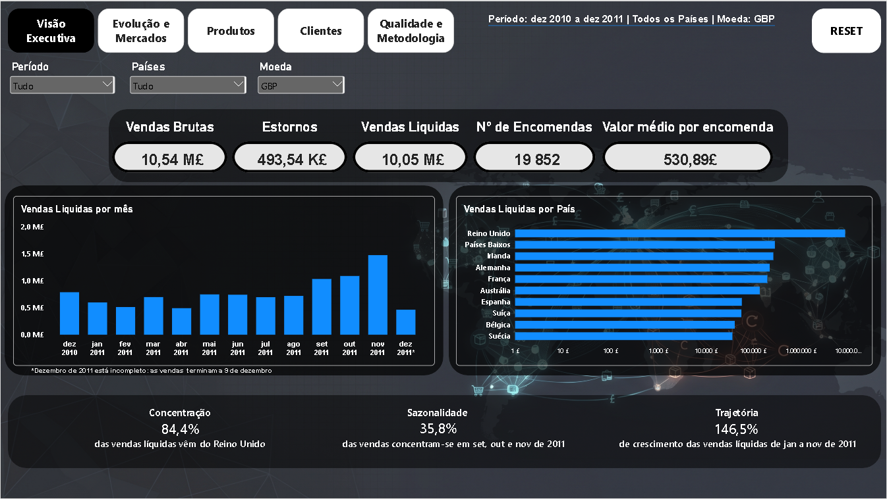
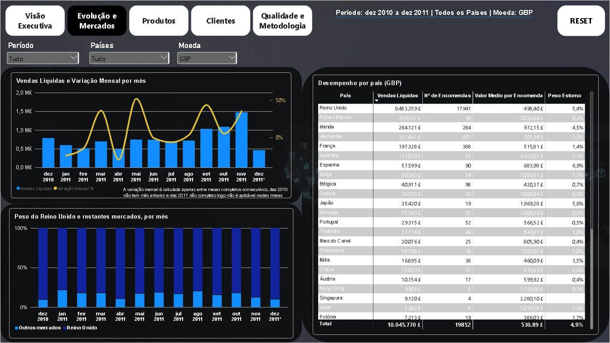
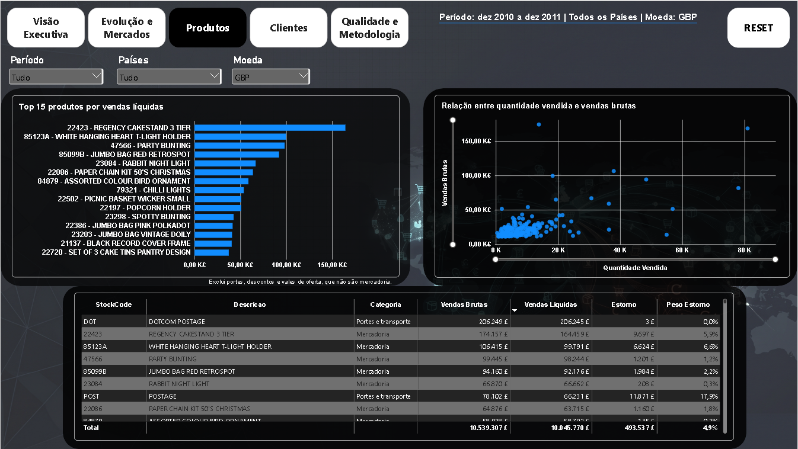
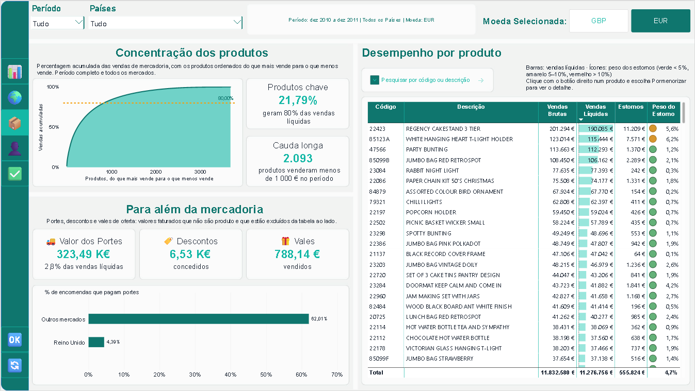
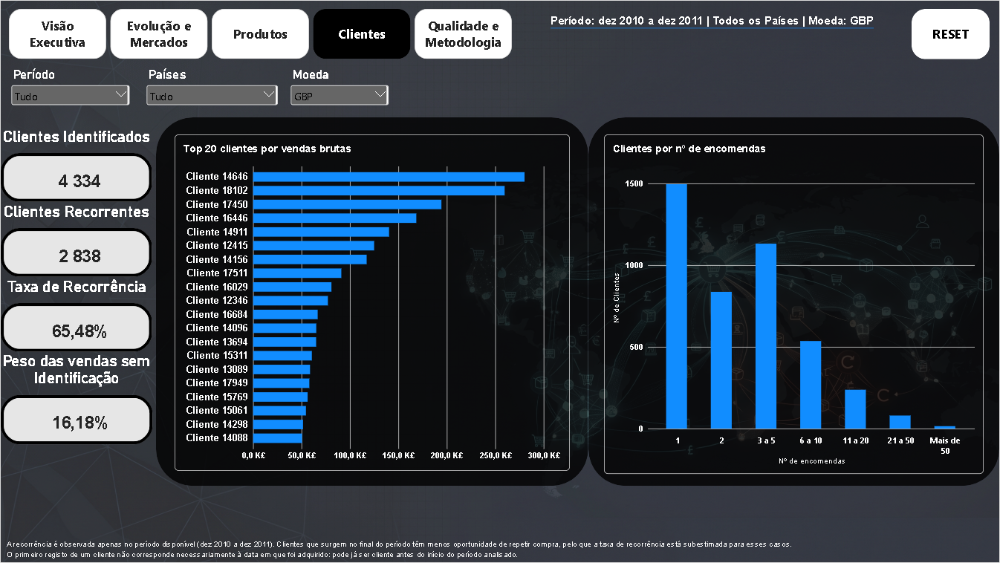
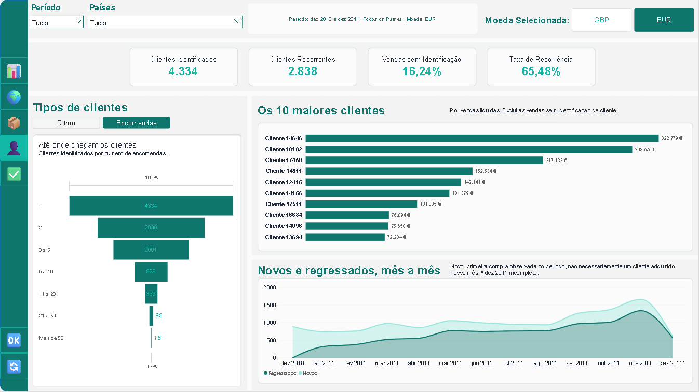
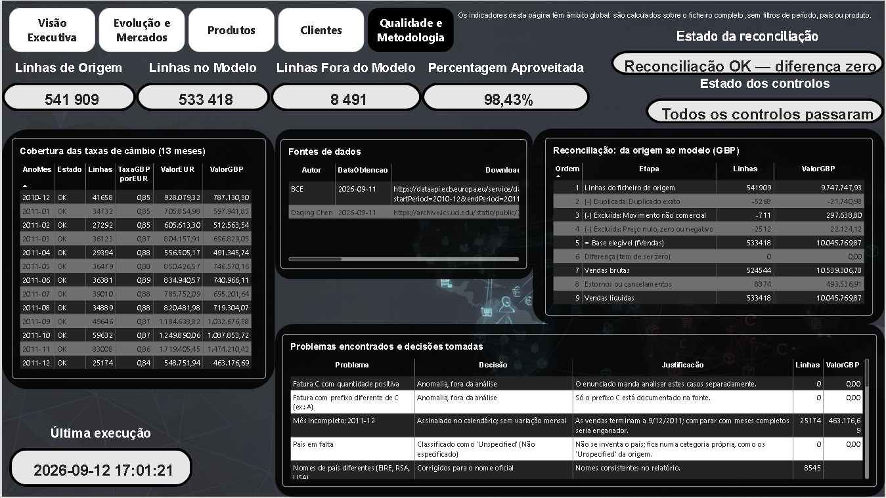
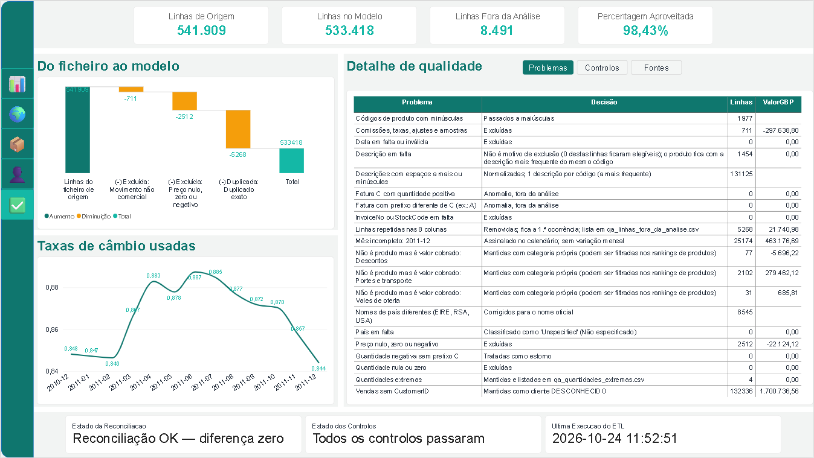

# Análise de vendas de e-commerce: ETL em Python e Power BI

Relatório de vendas de uma loja online britânica de artigos de oferta, construído de raiz. Um ETL em Python limpa, classifica e valida os dados. Um relatório Power BI de cinco páginas mostra onde está o negócio, como evolui e de que depende.

Os dados cobrem 13 meses de transações (dezembro de 2010 a dezembro de 2011). Os valores podem ser vistos em libras (GBP) ou em euros (EUR), com a conversão feita linha a linha à taxa mensal do Banco Central Europeu.

Este repositório tem **duas versões do relatório**. A primeira foi construída para resolver o problema de ponta a ponta. A segunda é uma reconstrução completa, feita depois de estudar o caminho de aprendizagem da Microsoft para a certificação **Power BI Data Analyst (PL-300)**, com novo design, novas análises, mais interatividade e um estudo de desempenho medido antes e depois.


---

## Índice

1. [Principais conclusões](#principais-conclusões)
2. [O relatório](#o-relatório)
3. [Versão 1 e versão 2: comparação](#versão-1-e-versão-2-comparação)
4. [O que há de novo na versão 2](#o-que-há-de-novo-na-versão-2)
5. [Otimização de desempenho](#otimização-de-desempenho)
6. [O que apliquei do estudo para a PL-300](#o-que-apliquei-do-estudo-para-a-pl-300)
7. [Processo ETL](#processo-etl)
8. [Modelo de dados](#modelo-de-dados)
9. [Como executar](#como-executar)
10. [Estrutura do repositório](#estrutura-do-repositório)
11. [Fontes de dados](#fontes-de-dados)
12. [Limitações](#limitações)

---

## Principais conclusões

- **O Reino Unido é o negócio.** Representa 84% das vendas líquidas e nunca desce abaixo de 79% em nenhum mês.
- **Os mercados externos compram como grossistas.** Os Países Baixos têm um valor médio por encomenda cerca de seis vezes superior ao do Reino Unido, com muito menos encomendas.
- **A sazonalidade é forte.** Setembro a novembro concentram 36% das vendas do período e novembro é também o mês com mais clientes a regressar.
- **Poucos produtos fazem a maior parte das vendas.** 22% dos produtos geram 80% do valor e mais de 2 000 produtos vendem menos de 1 000 no período inteiro.
- **A base de clientes é fiel.** 65% dos clientes identificados compram mais do que uma vez, mas 36% ficam por uma única compra.
- **Os portes pesam fora do Reino Unido.** 62% das encomendas externas pagam portes, contra 4% no Reino Unido.

---

## O relatório

| Página | Pergunta a que responde |
|---|---|
| Visão executiva | Quanto se vendeu, onde e com que tendência |
| Evolução e mercados | Como as vendas evoluem mês a mês e como se comporta cada país |
| Produtos | Que produtos sustentam o negócio e quanto depende de poucos |
| Clientes | Quantos clientes compram, com que ritmo e quantos regressam |
| Qualidade dos dados | O que ficou fora da análise, porquê e se os números batem certo |
| Ficha de produto | Detalhe de um produto, aberta por pormenorização (*drill-through*) |

---

## Versão 1 e versão 2: comparação

| Versão 1 | Versão 2 |
|---|---|
|  |  |
|  |  |
|  |  |
|  |  |
|  |  |
|  |  |

### Resumo das diferenças

| Aspeto | Versão 1 | Versão 2 |
|---|---|---|
| Design | Tema escuro com imagem de fundo e cores genéricas | Tema claro com paleta própria em verde-petróleo e cor de destaque só onde há algo a assinalar |
| Navegação | Botões de texto no topo de cada página | Menu lateral fixo com ícones e indicação da página ativa |
| Moeda | Lista pendente | Botões GBP / EUR sempre visíveis |
| Vistas alternativas | Não existiam | Marcadores para alternar entre vistas no mesmo espaço |
| Dicas de ferramenta | As predefinidas do Power BI | Páginas de dica personalizadas com indicadores do elemento apontado |
| Ficha de produto | Tabela de detalhe | Ficha completa com posição no ranking, peso no catálogo, evolução mensal, países, clientes e transações |
| Produtos | Top 15 e gráfico de dispersão | Curva de Pareto, produtos chave, cauda longa, tabela com barras e ícones e pesquisa por produto |
| Clientes | Indicadores e ranking | Tipos de cliente por ritmo e por número de encomendas, novos e regressados mês a mês e maiores clientes |
| Mercados | Barras por país em escala logarítmica | Mapa, dispersão de valor médio por encomenda e matriz de sazonalidade por país |
| Textos | Títulos fixos | Títulos e frases de conclusão que se ajustam aos filtros |
| Desempenho | Não medido | Medido com o Analisador de Desempenho e otimizado (até −72% de tempo de espera) |

---

## O que há de novo na versão 2

### Novo design

- **Paleta própria e coerente.** Verde-petróleo para a estrutura e os dados, laranja só para destacar o que merece atenção, vermelho para valores negativos e amarelo para o mês incompleto. Uma cor tem sempre o mesmo significado em todas as páginas.
- **Fundo claro e cartões brancos.** Cada bloco de análise tem um título que diz o que mostra e uma nota curta a explicar como ler o gráfico.
- **Hierarquia clara.** Indicadores principais no topo, análise no meio e detalhe em baixo ou à direita.
- **Menos ruído.** Saiu a imagem de fundo, a escala logarítmica e os eixos desnecessários. Os valores aparecem diretamente nas barras.
- **Fundos e bordas no próprio visual.** Em vez de formas desenhadas por trás de cada gráfico, cada visual usa o seu próprio fundo, borda arredondada e sombra. O aspeto é o mesmo e o relatório fica mais leve (ver [Otimização de desempenho](#otimização-de-desempenho)).

### Navegação

- **Menu lateral com ícones**, igual em todas as páginas, com a página ativa assinalada.
- **Botão de reposição** no fundo do menu, que limpa todos os filtros de uma vez.
- **Filtros sincronizados** de período e país entre as páginas de análise.
- **Linha de contexto** no topo de cada página com o período, os países e a moeda selecionados.

### Marcadores

Os marcadores permitem mostrar duas análises no mesmo espaço sem sobrecarregar a página. O utilizador alterna com um navegador de marcadores:

- **Clientes:** "Ritmo" (de quanto em quanto tempo os clientes compram) ou "Encomendas" (quantas encomendas fizeram).
- **Evolução e mercados:** "Mês a mês" (matriz de sazonalidade por país) ou "Indicadores" (tabela de indicadores por país).
- **Qualidade dos dados:** navegação entre as diferentes vistas de controlo e reconciliação.

Os marcadores guardam apenas o que está visível e não os filtros, para que mudar de vista não reponha seleções antigas.

### Dicas de ferramenta personalizadas

Ao passar o rato sobre um elemento aparece uma página de dica desenhada para o efeito, em vez da caixa predefinida:

- **No mapa e nos gráficos por país:** vendas líquidas, peso no total global, número de encomendas e valor médio por encomenda desse país.
- **Nos indicadores da visão executiva:** uma explicação curta de como o valor é calculado.

### Ficha de produto (*drill-through*)

Clique direito num produto e **Pormenorizar** abre a ficha desse produto:

- posição no ranking (por exemplo "nº 1 320 de 3 813") e peso no catálogo;
- vendas líquidas, quantidade vendida, preço médio unitário e peso dos estornos;
- vendas por mês, peso de cada país e principais clientes;
- lista das transações, com valores em GBP e EUR.

### Novas análises

**Produtos**
- **Curva de Pareto** com a linha dos 80%, que mostra quanto as vendas dependem de poucos produtos.
- **Produtos chave** (percentagem de produtos que gera 80% das vendas) e **cauda longa** (produtos que venderam menos de 1 000 no período).
- **"Para além da mercadoria":** portes, descontos e vales separados dos produtos, com a taxa de encomendas que pagam portes no Reino Unido e fora dele.
- **Tabela de desempenho** com barras de dados nas vendas líquidas, ícones de semáforo no peso dos estornos e **caixa de pesquisa** por código ou descrição.

**Evolução e mercados**
- **Mapa** das vendas por país.
- **Gráfico de dispersão** entre número de encomendas e valor médio por encomenda, que separa os mercados grossistas dos restantes.
- **Matriz de sazonalidade** com o peso de cada mês nas vendas de cada país, colorida como mapa de calor.

**Clientes**
- **Tipos de cliente por ritmo de compra:** compra única, ocasionais, regulares e muito ativos.
- **Novos e regressados mês a mês**, com nota a explicar que "novo" significa primeira compra observada no período.
- **Os 10 maiores clientes** por vendas líquidas.

**Visão executiva**
- **Frases de conclusão dinâmicas** sobre concentração, sazonalidade e trajetória, que mudam com os filtros e destacam a laranja quando há um alerta.

### Formatação condicional e textos dinâmicos

- Cores que reagem aos valores: concentração acima de 60% a laranja, trajetória negativa a vermelho, dezembro de 2011 assinalado como incompleto.
- Ícones de semáforo no peso dos estornos: verde abaixo de 5%, amarelo entre 5% e 10% e vermelho acima de 10%.
- Medidas de texto para os cartões, com abreviaturas (K, M) e a moeda selecionada, e "n/a" quando um valor não se aplica.

---

## Otimização de desempenho

### Método

Medido com o **Analisador de Desempenho** do Power BI Desktop, nas mesmas condições antes e depois:

1. Relatório guardado numa página em branco e Power BI fechado por completo, para começar com a cache vazia.
2. Gravação iniciada e percurso feito por ordem: as cinco páginas, mudanças de filtro em cada uma e a ficha de produto.
3. Resultados exportados em JSON (`desempenho/antes.json` e `desempenho/depois.json`) e analisados visual a visual.

### Diagnóstico

A análise do ficheiro "antes" mostrou **dois problemas diferentes**:

1. **Duas medidas DAX eram responsáveis por quase todo o tempo de cálculo.** A curva de Pareto demorava 5,4 s e o cartão de produtos chave 4,7 s, enquanto todas as outras medidas ficavam abaixo de 0,15 s. Para cada um dos cerca de 3 900 produtos, a medida voltava a somar todos os produtos acima dele, e o resultado nem sequer dependia dos filtros.
2. **O resto do tempo era desenho, não cálculo.** Em muitas interações o DAX demorava 0 ms (vinha da cache), mas a página demorava na mesma 4 a 5 s. A página de clientes tinha 53 elementos, incluindo 10 formas e 12 caixas de texto. O Power BI desenha os visuais numa fila, por isso um gráfico que demora 40 ms a desenhar esperava quase 3 s pela vez dele.

### O que mudou

| Mudança | Porquê |
|---|---|
| Pareto passou de medida para **coluna calculada** | O valor não depende dos filtros, por isso passa a ser calculado uma vez na atualização dos dados e não em cada clique |
| **Formas de fundo removidas**, substituídas pelo fundo, borda e sombra do próprio visual | Menos elementos na fila de desenho sem mudar o aspeto (na página de clientes passou de 10 formas para 1) |
| **Cartões agrupados** no cartão novo, que aceita várias medidas | Um visual em vez de vários (na visão executiva passou de 13 para 9 cartões) |
| **Redução de consultas** nas segmentações | Arrastar um filtro deixou de gerar uma consulta por cada posição intermédia |
| **Interações entre visuais revistas** | Visuais que não precisam de reagir a um clique deixaram de ser recalculados |
| **Colunas e medidas sem uso removidas** | Colunas que nenhum visual usa deixaram de ser exportadas pelo ETL e as medidas que caíram em desuso foram apagadas |

### Ferramentas externas

| Ferramenta | Para que a usei |
|---|---|
| [DAX Studio](https://daxstudio.org/) | **View Metrics** (VertiPaq Analyzer) para medir o tamanho do modelo e de cada coluna e identificar as mais pesadas |
| [Measure Killer](https://en.brunner.bi/measurekiller) | Identificar as colunas e medidas que já não eram usadas em nenhum visual, filtro, medida ou relação |

As colunas sem uso, como a `LinhaOrigem`, continuam a existir em memória durante a execução do ETL, porque os controlos de qualidade precisam delas, mas já não são gravadas no `fVendas.csv`. A lista está em `etl/configuracao.py` (`COLUNAS_SO_ETL`).

### Resultados

Tempo até a página ficar pronta, em mediana:

| Página | Ação | Antes | Depois | Ganho |
|---|---|---:|---:|---:|
| Visão executiva | abrir (cache fria) | 3,4 s | 3,0 s | −9% |
| | mudar filtro | 1,2 s | 0,6 s | **−50%** |
| Evolução e mercados | abrir | 2,4 s | 2,7 s | ≈ igual |
| | mudar filtro | 2,3 s | 1,1 s | **−51%** |
| Produtos | abrir | 8,0 s | 2,3 s | **−72%** |
| | mudar filtro | 5,0 s | 1,5 s | **−70%** |
| Ficha de produto | abrir | 2,6 s | 1,5 s | −42% |
| Clientes | abrir | 3,4 s | 1,4 s | **−60%** |
| | mudar filtro | 4,7 s | 1,5 s | **−69%** |
| Qualidade dos dados | abrir | 3,1 s | 1,6 s | −49% |

No DAX:

| Medida | Antes | Depois |
|---|---:|---:|
| Curva de Pareto (`Pct Acumulado`) | 5,4 s | 0,09 s |
| Produtos chave (`Pct Produtos para 80`) | 4,7 s | 0,10 s |
| Consulta mais lenta do relatório | 5,4 s | 0,15 s |

**Notas:** a abertura da primeira página quase não muda porque inclui a ligação ao modelo, que demora sempre o mesmo. A página de evolução tem o mapa e o gráfico de dispersão, que são os visuais mais pesados de desenhar, e a diferença de 0,3 s está dentro da variação normal entre medições.

### Lição

Medir antes de otimizar. Sem o Analisador de Desempenho, a tentação seria reescrever as medidas de clientes, que parecem as mais complexas. Os dados mostraram que eram rápidas e que o problema estava numa medida de Pareto e no número de elementos por página.

---

## O que apliquei do estudo para a PL-300

| Tema do caminho de aprendizagem | Onde está no projeto |
|---|---|
| Modelação em estrela, relações e tabelas desligadas | `fVendas` com cinco dimensões, `dMoeda` e `dFaixaEncomendas` desligadas |
| Contexto de filtro e `CALCULATE` (`ALL`, `ALLSELECTED`) | Pesos no total, peso de cada mês no país, crescimento entre o primeiro e o último mês completos |
| Medidas e colunas calculadas: quando usar cada uma | Pareto e ranking de produtos como colunas, o resto como medidas |
| Marcadores, navegação e *drill-through* | Vistas alternativas, menu lateral e ficha de produto |
| Dicas de ferramenta em página de relatório | Dicas por país e explicações dos indicadores |
| Formatação condicional | Semáforos, barras de dados, mapa de calor e cores por regra |
| Otimização de desempenho | Analisador de Desempenho, redução de visuais, redução de consultas e interações |
| Parâmetros no Power Query | Caminho da pasta do projeto definido num parâmetro |

---

## Processo ETL

```
Online Retail.xlsx (UCI) ─┐
                          ├─► ETL em Python ─► CSV (modelo + qualidade) ─► Power BI
data_cambio.csv (BCE) ────┘        │
                                   └─► etl.log (registo de cada execução)
```

### Destaques técnicos

- **Reconciliação a zero.** O valor da origem é igual ao valor excluído mais o valor do modelo, ao cêntimo.
- **10 controlos automáticos, 6 deles críticos.** Se um controlo crítico falhar, o ETL pára antes de gravar e os ficheiros anteriores ficam intactos.
- **Câmbio validado.** Cada mês tem exatamente uma taxa positiva e a junção é feita com `validate="many_to_one"`, o que impede que uma taxa repetida duplique vendas.
- **Conversão linha a linha.** Cada venda é convertida com a taxa do seu mês e só depois se soma, nunca com uma média das taxas.
- **Execução repetível.** Correr o ETL duas vezes produz exatamente os mesmos ficheiros.
- **Identificadores como texto.** Números de fatura, produtos e clientes são lidos como texto para não perder zeros nem letras.
- **Cada linha com um só motivo.** As regras de classificação são aplicadas por ordem e uma linha que já tem motivo não é reclassificada, por isso nada é contado duas vezes.

### Tratamento dos dados

| Passo | Linhas | Valor (GBP) |
|---|---:|---:|
| Linhas do ficheiro de origem | 541 909 | 9 747 747,93 |
| (−) Duplicados exatos | −5 268 | −21 740,98 |
| (−) Preço nulo, zero ou negativo | −2 512 | +22 124,12 |
| (−) Movimentos não comerciais | −711 | +297 638,80 |
| **= Base da análise (`fVendas`)** | **533 418** | **10 045 769,87** |

98,4% das linhas de origem entram na análise.

### Decisões principais

- **Duplicados:** linhas iguais nas 8 colunas de origem são removidas, mantendo a primeira ocorrência. A evidência fica guardada com o número da linha original.
- **Estornos:** as linhas com quantidade negativa ficam no modelo e abatem às vendas, para que as vendas líquidas reflitam o que foi realmente faturado.
- **Movimentos não comerciais:** códigos como ajustes manuais, taxas bancárias ou amostras são separados das vendas.
- **Clientes sem identificação:** as vendas entram nos totais mas ficam de fora das análises de clientes.

---

## Modelo de dados

Esquema em estrela:

- **Factos:** `fVendas` (uma linha por linha de fatura elegível)
- **Dimensões:** `dCalendario`, `dProduto`, `dCliente`, `dPais`, `dCambio`
- **Auxiliares desligadas:** `dMoeda` (seletor de moeda) e `dFaixaEncomendas` (escalões de clientes)
- **Qualidade:** tabelas `qa_*` com as linhas excluídas, os controlos e a reconciliação


---

## Como executar

1. Instalar as dependências:

   ```
   python -m pip install -r etl/requirements.txt
   ```

2. Colocar os ficheiros de origem na pasta `dados/origem/`:
   - `Online Retail.xlsx`, descarregado do [UCI Machine Learning Repository](https://archive.ics.uci.edu/dataset/352/online+retail)
   - `data_cambio.csv`, descarregado do [Portal de Dados do BCE](https://data.ecb.europa.eu/data/datasets/EXR/EXR.M.GBP.EUR.SP00.A) (série `EXR.M.GBP.EUR.SP00.A`)

3. Correr o ETL:

   ```
   python etl/executar_etl.py
   ```

4. Abrir o ficheiro `.pbix` da versão 2 e, em **Transformar dados → Editar parâmetros**, indicar a pasta onde está o projeto. Depois carregar em **Atualizar**.

---

## Estrutura do repositório

```
├── etl/
│   ├── executar_etl.py        # ponto de entrada
│   ├── configuracao.py        # caminhos, datas e regras
│   ├── requirements.txt
│   └── functions/             # ler, limpar, câmbio, modelo, controlos, qualidade, guardar
├── dados/
│   ├── origem/                # ficheiros descarregados (não incluídos)
│   ├── modelo/                # CSV que alimentam o Power BI
│   └── qualidade/             # evidência das exclusões e dos controlos
├── powerbi/
│   ├── v1/                    # primeira versão do relatório
│   └── v2/                    # versão atual
├── desempenho/                # exportações do Analisador de Desempenho (antes e depois)
├── docs/                      # diagrama do modelo e capturas do relatório
│   ├── v1/                    # capturas da primeira versão
│   └── v2/                    # capturas da versão atual
└── README.md
```

---

## Tecnologias

- **Python** (pandas, openpyxl, logging) para extração, limpeza e validação
- **Power BI Desktop** (Power Query, DAX, modelo em estrela, marcadores, dicas de ferramenta, Analisador de Desempenho)
- **Git e GitHub** para versionamento

---

## Fontes de dados

- **Online Retail**, UCI Machine Learning Repository. Chen, D. (2015). Licença [CC BY 4.0](https://creativecommons.org/licenses/by/4.0/).
- **Taxas de câmbio GBP/EUR**, Banco Central Europeu, série mensal `EXR.M.GBP.EUR.SP00.A`.

---

## Limitações

- **Dezembro de 2011 está incompleto** (os dados terminam a 9 de dezembro), por isso aparece assinalado nos gráficos e fica fora das comparações entre meses.
- **Cerca de 16% das vendas não têm cliente identificado**, o que limita as análises de clientes a quem tem identificação.
- **Os clientes "novos" são novos no período observado**, não necessariamente novos para a loja, já que não há dados anteriores a dezembro de 2010.
- **Alguns duplicados podem ser compras legítimas repetidas.** É improvável, porque coincidem até ao minuto, mas o impacto está quantificado e a evidência guardada.
- **A curva de Pareto é calculada em GBP e sobre o período completo.** Como mostra percentagens, a diferença para euros é desprezável. Ser fixa foi o que a tornou rápida.
- **Não há dados de custos**, por isso a análise é de vendas e não de margem.

---

**Gabriel Aires Mendes** · [LinkedIn](https://www.linkedin.com/in/mendgabriel/) · [GitHub](https://github.com/gabz2009)
